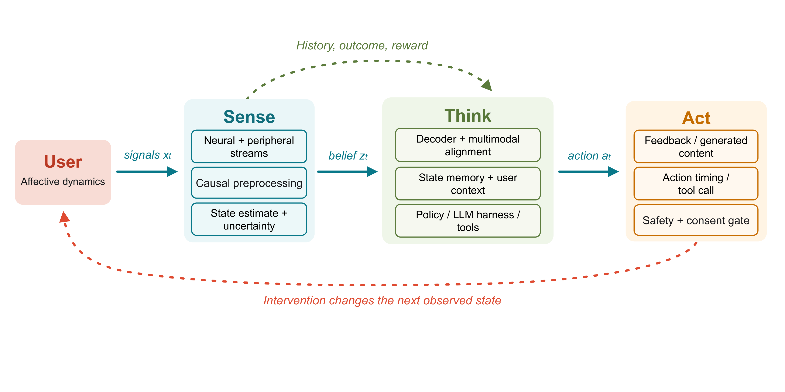
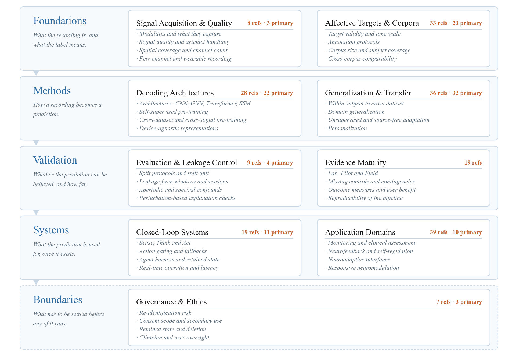
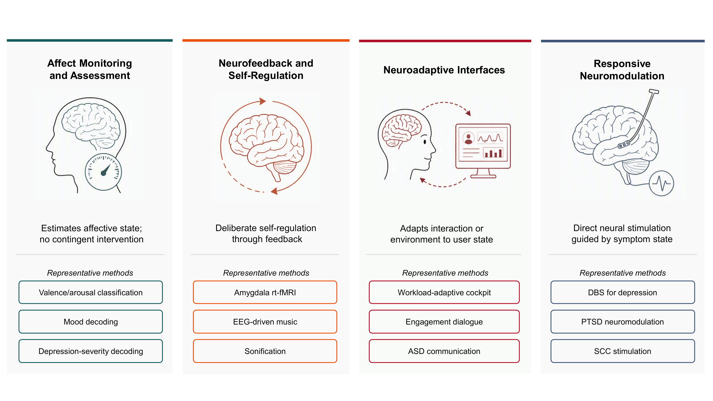

# Affective BCI Agents

**A working map of the field that turns a brain signal into an action.**

127 references · 9 research areas · 16 corpora · 188 links

## What this is

Affective BCI turns a brain signal into something that **helps a person** — a
display that adjusts, a word that comes back, a stimulation that fires at the
right moment. Getting there is not one problem but a chain, and each link in
the chain breaks in its own way.

This repository is a map of that chain. Every reference is filed under the
**research area** it belongs to, with a note on what it settles and where it
falls short. The nine areas are the ones this field is actually organised
around, so the map and the literature use the same words.

<b>Sense — Think — Act</b> — the closed loop, and the stage most systems stop at.

The signal becomes a belief, the belief becomes a proposal, and something
decides whether the proposal reaches the person. Most systems in this field
stop after the first step and report an accuracy; the loop is where the hard
problems live.

## Start here

<table>
<tr>
<td width="50%" valign="top">

**New to the field**

1. [Affective Targets & Corpora](resources/by-area/corpora.md) — why the label
   matters more than the signal
2. [Evaluation & Leakage Control](resources/by-area/evaluation.md) — the split
   decides the question your number answers
3. [Closed-Loop Systems](resources/by-area/closed-loop.md) — how a decoder
   becomes a system

</td>
<td width="50%" valign="top">

**Building a system**

1. [Generalization & Transfer](resources/by-area/generalization.md) — will it
   work on a person you have never seen
2. [Decoding Architectures](resources/by-area/architectures.md) — what to build
3. [Application Domains](resources/by-area/applications.md) — where it goes

</td>
</tr>
<tr>
<td valign="top">

**Reviewing work in this area**

- [Evaluation & Leakage Control](resources/by-area/evaluation.md) — leakage,
  spectral confounds, split protocols
- [Evidence Maturity](resources/by-area/maturity.md) — what a pilot study has to
  report before it counts
- [Governance & Ethics](resources/by-area/governance.md) — consent, retention,
  re-identification

</td>
<td valign="top">

**Working on the index**

Found a paper that should be here, or a corpus that was missed? Open an issue
and say which area it belongs to.

- [Add a reference](.github/ISSUE_TEMPLATE/add-reference.yml)
- [Add a dataset](.github/ISSUE_TEMPLATE/add-dataset.yml)
- [Report a broken link](.github/ISSUE_TEMPLATE/broken-link.yml)

</td>
</tr>
</table>

## The research areas

Nine areas, in five tiers. The tiers are the order a reader meets them in:
what the recording is, how it becomes a prediction, whether the prediction can
be believed, what it is used for, and what has to be settled before any of it
runs.

<b>The taxonomy</b> — five tiers, nine areas, and the four things each area is judged by.

| Tier | Research area | What it settles | Refs |
|:--|:--|:--|--:|
| **Foundations** | [Signal Acquisition & Quality](resources/by-area/signal.md) | What the recording measures, and how much of it can be trusted | 8 |
| | [Affective Targets & Corpora](resources/by-area/corpora.md) | Why a measurable proxy stands in for emotion, and what it then means | 33 |
| **Methods** | [Decoding Architectures](resources/by-area/architectures.md) | How a recording is organised, and which objective decides what the model keeps | 28 |
| | [Generalization & Transfer](resources/by-area/generalization.md) | The unit held out during testing states how far a result can travel | 36 |
| **Validation** | [Evaluation & Leakage Control](resources/by-area/evaluation.md) | A favourable split or repeated test-set access can beat a better architecture | 9 |
| | [Evidence Maturity](resources/by-area/maturity.md) | Lab estimates the state; Pilot changes something; Field holds up over time | 19 |
| **Systems** | [Closed-Loop Systems](resources/by-area/closed-loop.md) | Sense proposes, Act decides, a harness keeps the system inside what was tested | 19 |
| | [Application Domains](resources/by-area/applications.md) | Four families of system, and what each does with an estimate once it has it | 39 |
| **Boundaries** | [Governance & Ethics](resources/by-area/governance.md) | A neural recording reveals more than the purpose it was collected for | 7 |

The nine areas in one table: [research-area index](resources/by-area/README.md).

A reference is filed under every area it informs, so the counts above sum to
more than 127. The area it informs most often is its primary home.

## Four kinds of system

<b>Four families of system</b> — what each one does with an estimate once it has it.

**Monitoring** estimates a state and stops there. **Neurofeedback** hands the
state back to the person to regulate. **Neuroadaptive** interfaces change the
environment to fit the person. **Responsive neuromodulation** changes the
person's brain state directly. The four are not interchangeable, and a result
from one does not transfer to another.

## Corpora and evidence

<b>Corpus scale</b> — participants per corpus on a log scale, grouped by how the target was elicited.

**Corpora.** Sixteen corpora, grouped by how the target was elicited — by the
experimenter, reported by the participant, or read from behaviour. The groups
are not interchangeable, and a number from one does not transfer to another.

<table>
<tr>
<td width="52%" valign="middle" align="center">

<b>Lab · Pilot · Field</b> — what each level of evidence tests.

</td>
<td valign="middle">

**Maturity.** Lab tests the estimate. Pilot lets the estimate change something
during a limited experiment. Field uses the complete system repeatedly in the
setting it was built for. Most published work stops at the first.

The ladder runs one way: a Lab result does not become a Pilot result because
the method was reused, and a Pilot result does not become a Field result
because the evaluation was thorough.

</td>
</tr>
</table>

## What is here

| If you want to | Go to |
|:--|:--|
| Browse the references by research area | [The nine research areas](resources/by-area/README.md) |
| See every reference in one table | [All 127 references](resources/papers.md) |
| Filter the index yourself | [The index as data](resources/papers.json) |
| Compare the corpora | [All 16 corpora](resources/corpora.md) |
| Work through a checklist | [Playbooks](playbooks/README.md) |

Every reference links to the publisher's page, and to the preprint or the code
where one exists.

## Contributing

A missing reference, a corpus, a method, a system, a critique that changes how
the field should be measured — all of it welcome. See
[CONTRIBUTING.md](CONTRIBUTING.md).

**If this map was useful, a star helps others find it.**

