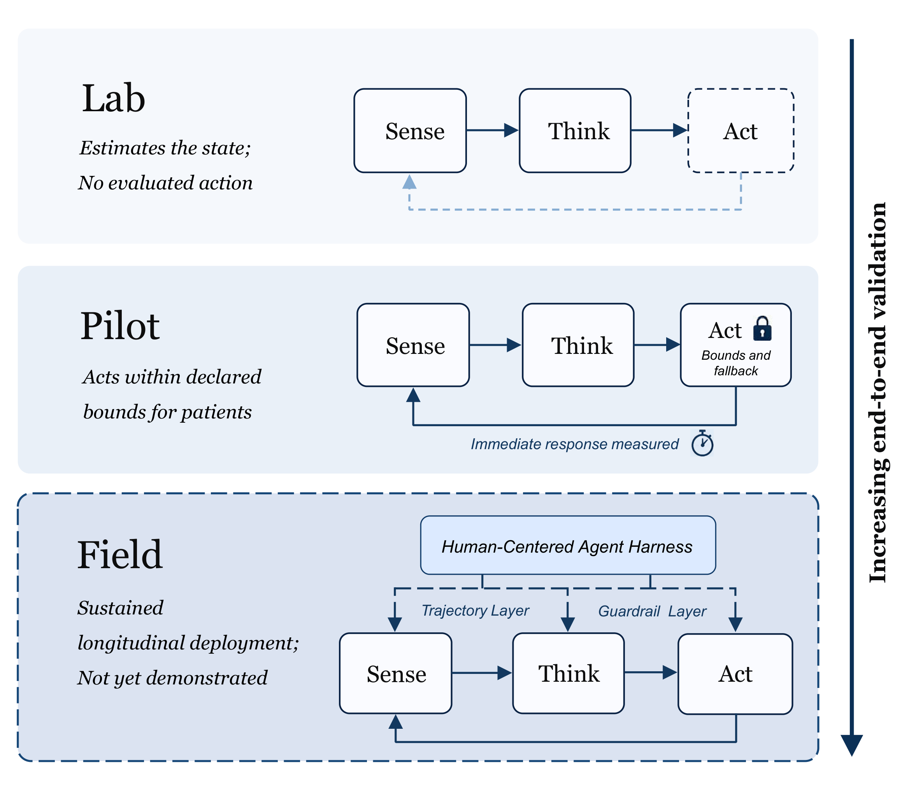

# Reviewing a pilot system

Three levels, and the question each one answers is different. Most disputes
about a system's value come from reading a Level 1 result as if it were a
Level 3 one.



---

| Level | The question it answers | Typical duration | The claim it licenses |
|---|---|---|---|
| **Lab** | Can the state be estimated at all? | One session | "The signal carries information about the state" |
| **Pilot** | Can the estimate change something, under controlled conditions? | Weeks | "Driving the estimate changes an outcome" |
| **Field** | Does the whole system hold up in its intended setting? | Months | "Using this system, people are better off" |

A Level 1 result cannot support a Level 3 claim. The gap between them is not
a matter of sample size — it is a matter of what the system is allowed to do.

---

## Level 1 · Lab

> Does the signal carry information about the state?

**What must be present**

- [ ] The state was **elicited or reported** under a protocol that is
      described precisely enough to reproduce.
- [ ] The evaluation split held out **people**, not windows.
- [ ] Per-person performance is reported, not only the pooled number.
- [ ] The result is compared against a **baseline** that a reader can
      reproduce.

**What must not be claimed**

- That the system works. A Lab result is about the signal, not the system.
- That the state was detected **in real time**. Offline decoding with a
  subject-informed split is not the same claim.

**Common gap.** The reported accuracy is a pooled number over a
subject-informed split, and it is presented as evidence that the system
detects the state in the user's own setting.
→ See [Is that accuracy real?](../resources/by-question/evaluation.md)

---

## Level 2 · Pilot

> Can the estimate change something, under controlled conditions?

This is the level where the loop is closed for the first time, and where
controls become essential rather than optional.

**What must be present**

- [ ] The system **acted** on the estimate — the loop was closed, not
      simulated.
- [ ] A **contingency control**: yoked feedback, or no feedback.
- [ ] The outcome is measured at the level of the **person**, not only the
      decoder.
- [ ] The system's latency is reported.
- [ ] The number of participants is reported, along with how they were
      recruited and whether anyone withdrew.

**What must be claimed carefully**

- That the system changed the outcome **in the conditions tested**, not that
  it works in general.
- The **scope** of the claim: which state, which population, which duration.

**Common gaps.** These are the failures that recur in published pilots:

| Gap | Why it matters |
|---|---|
| No control group | A change over time is not evidence that the system caused it |
| No significance test | An effect measured once cannot be distinguished from noise |
| The adapted condition is not compared to a baseline | Adaptation that changes the measure is not adaptation that helps |
| The baseline is removed in a follow-up | A system that needs the neural signal removed, and works better without it, is not a neural system |
| No user-level outcome | An intermediate improvement with no consequence for the person |

> A musical BCI in which the control signal showed no effect on the target
> emotion; a dialogue system where adaptation changed the engagement measure
> but not learning; a workload-adaptive guidance system where adaptation
> produced more errors than the baseline; an image-generation system whose
> second experiment removed the neural input. These are documented in
> [How strong is the evidence?](../resources/by-question/maturity.md).

---

## Level 3 · Field

> Does the whole system hold up where it is actually used?

**What must be present**

- [ ] The **complete** system was used: real hardware, real users, real
      stakes.
- [ ] Use over **weeks or months**, not sessions.
- [ ] The outcome is a **user-level** measure: symptoms, function, quality
      of life, or a task that matters to the person.
- [ ] The **comparison** is against current practice, or against the system
      without the adaptation.
- [ ] Adverse events and dropouts are reported.
- [ ] Someone **responsible** is named: a clinician, an approver, a
      regulator.

**What must be claimed carefully**

- The result applies to the **population and setting** tested.
- The consent and governance arrangements are part of the claim, not an
  appendix.

**Common gap.** The system is described as field-ready because it ran
outside the lab, while the analysis is still a Level 1 accuracy on
laboratory data.

---

## The reviewer's question

When reviewing a pilot system, ask which level each claim in the paper
belongs to, then check the gap:

```
Claim in the paper        Level claimed    Evidence present    Gap
─────────────────────────────────────────────────────────────────────
"The signal contains      Lab              cross-subject      none
 information about
 affect"

"The system improves     Pilot            yoked control,      outcome measure
 emotion regulation"                     significance        missing

"The approach is ready    Field            6-week study,       comparison
 for clinical use"                       20 patients,        missing
                                          no control
```

Most papers that overclaim are not wrong about Level 1. They are silent
about Levels 2 and 3, and the abstract collapses the difference.

---

## Related

- [How strong is the evidence?](../resources/by-question/maturity.md)
- [Designing an evaluation](evaluation-protocol.md)
- [Where is the boundary?](../resources/by-question/governance.md)
