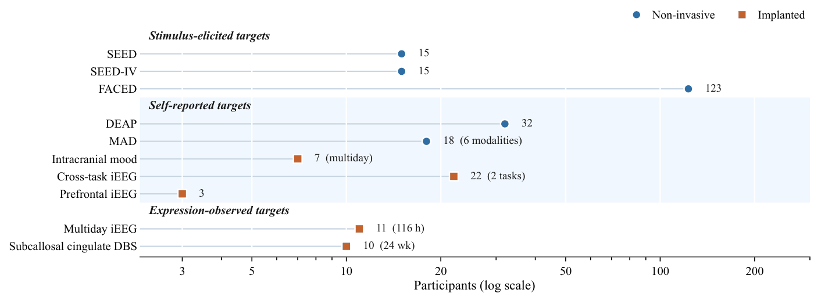

# Resource index

127 references from the affective BCI literature, every one linked. Organised by
the **research area** a reference belongs to, not by the order of a paper.

**188 links, all verified.** The link checker runs in CI, so a dead DOI fails
the build instead of sitting in a table.

## The nine research areas

Each area is a page of linked references, with a note per reference on **what
it settles**, and where it falls short. The five tiers are the order a reader
meets them in.

| Tier | Research area | References | Strongest on |
|:--|:--|--:|:--|
| **Foundations** | [Signal Acquisition & Quality](by-area/signal.md) | 8 | Modalities, artefact handling, few-channel recording |
| | [Affective Targets & Corpora](by-area/corpora.md) | 33 | Target validity, annotation protocol, corpus scale |
| **Methods** | [Decoding Architectures](by-area/architectures.md) | 28 | CNN / GNN / Transformer / SSM, self-supervised pre-training |
| | [Generalization & Transfer](by-area/generalization.md) | 36 | Cross-dataset transfer, domain generalisation, personalisation |
| **Validation** | [Evaluation & Leakage Control](by-area/evaluation.md) | 9 | Split protocols, leakage, spectral confounds |
| | [Evidence Maturity](by-area/maturity.md) | 19 | Lab / Pilot / Field, missing controls, outcome measures |
| **Systems** | [Closed-Loop Systems](by-area/closed-loop.md) | 19 | Sense / Think / Act, action gating, agent harnesses |
| | [Application Domains](by-area/applications.md) | 39 | Monitoring, neurofeedback, neuroadaptive, neuromodulation |
| **Boundaries** | [Governance & Ethics](by-area/governance.md) | 7 | Consent scope, re-identification, retained state |

A reference appears under every area it informs, so the counts sum to more
than 127. The area it informs most often is its primary home.

**[Open the research-area index](by-area/README.md)** for the same nine areas
arranged by tier.

## Other views

- **[All 127 in one table](papers.md)** — alphabetical, with venue and links
- **[All 16 corpora](corpora.md)** — scale, modality, target, and source
- **[papers.json](papers.json)** — the same index as data. Filter by area, tier,
  year, venue, whether code is available, or whether the paper supports a
  Lab / Pilot / Field claim.

```python
import json

data = json.load(open("resources/papers.json", encoding="utf-8"))

# Everything with public code
with_code = [p for p in data["papers"] if p["code"]]

# Everything filed under the evaluation area
eval_papers = [p for p in data["papers"] if "evaluation" in p["areas"]]

# Everything in the Systems tier
systems = [p for p in data["papers"] if p["tier"] == "Systems"]

# Papers that support a Field-level claim
field = [p for p in data["papers"] if "Field" in p["levels"]]

# The tier an area belongs to, and the one line that states what it settles
print(data["areas"]["evaluation"]["tier"])
print(data["areas"]["evaluation"]["settles"])
```

## Corpora

**[All 16 corpora, with scale, modality, target and source](corpora.md)** — grouped
by how the target was elicited: by the experimenter, reported by the
participant, or read from behaviour. The grouping matters more than the size,
because a number from one group does not transfer to another.



<p align="center"><sub><b>Corpus scale</b> — participants per corpus on a log scale, grouped by how the target was elicited.</sub></p>

## Regenerating

```
python scripts/check_index.py          # the index agrees with itself
python scripts/check_links.py          # verify every link resolves
python scripts/check_citations.py      # verify prose citations match the index
python scripts/check_relative_links.py # verify relative paths point at real files
python scripts/check_layout.py         # verify the pages follow the layout conventions
```

The index is generated, not hand-written. Edit the generator, not the output.

## Related

- [Playbooks](../playbooks/README.md) — checklists for running an evaluation,
  designing a loop, or reviewing a pilot system
- [Contributing](../CONTRIBUTING.md)
